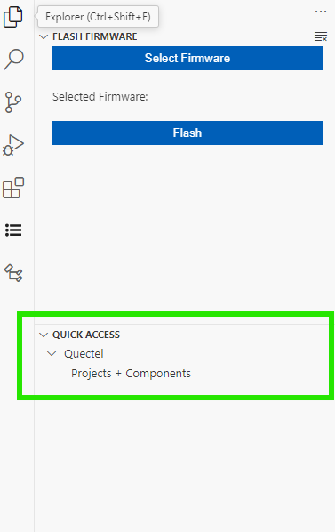
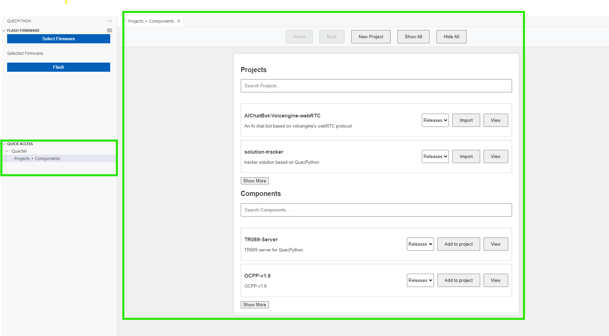
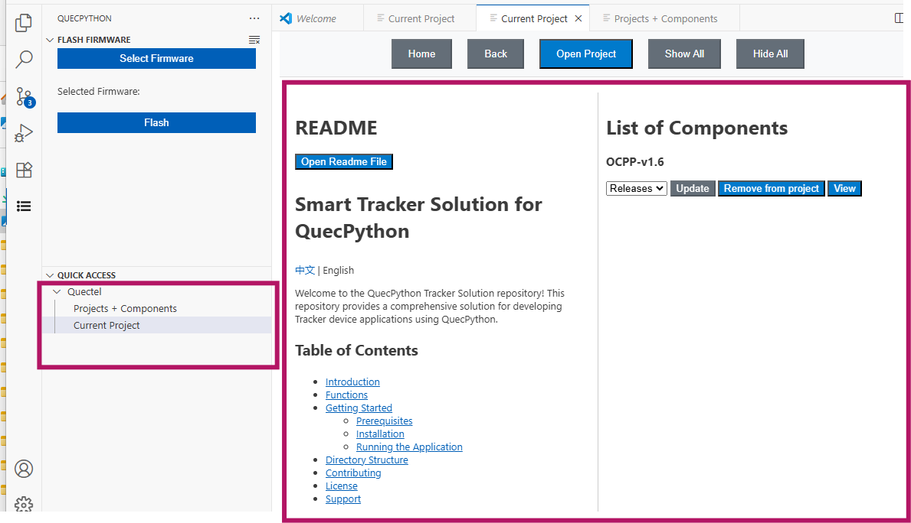
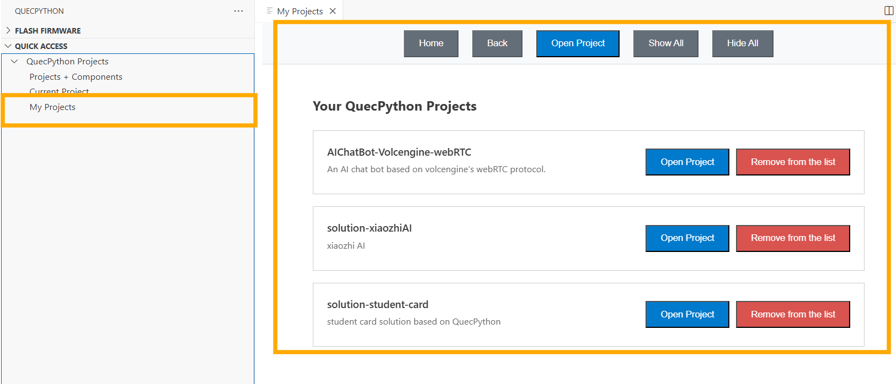

# QuecPython

English | [简体中文](README.zh-CN.md)

The QuecPython VS Code extension connects to Quectel modules running QuecPython firmware. It provides firmware selection and flashing, serial REPL/AT interaction, script transfer and execution, a device file-system view, and project/component management.

## Contents

- [Part 1: User Guide](#user-guide)
- [1. Before You Start](#requirements)
- [2. Installation](#installation)
- [3. Interface Tour](#interface)
- [4. Quick Start: Connect, Transfer, Run](#quick-start)
- [5. Firmware Selection and Flashing](#firmware)
- [6. Device File System](#file-system)
- [7. Projects and Components](#projects)
- [8. Commands and Settings](#settings)
- [9. FAQ](#faq)
- [10. Related Links](#feedback)

# Part 1: User Guide

## 1. Before You Start

### Module and USB driver

- Prepare a QuecPython-capable module/board, stable power, and a data-capable USB cable.
- Install the official Windows USB driver for the exact module and check port enumeration in Device Manager.
- If compatible QuecPython firmware is already running, proceed directly to connection; reflashing is unnecessary.
- For first-time programming or firmware changes, back up important device files and follow section 5.
- REPL, AT, logging, and download interfaces may be separate. Use the module and firmware documentation to identify ports and baud rates.

## 2. Installation

1. Press `Ctrl+Shift+X` in VS Code to open Extensions.
2. Search for `QuecPython`, verify publisher `Quectel` and extension ID `Quectel.qpy-ide`.
3. Install it and enable dependencies or reload the window when prompted.
4. Open the `QuecPython` Activity Bar view and check for `Flash Firmware` and `Quick Access`.
5. Check the installed version on the extension details page. Images of other releases or extensions do not establish your current UI.

## 3. Interface Tour

| Location | Function |
| --- | --- |
| QuecPython Activity Bar: `Flash Firmware` | `Select Firmware` chooses online/local firmware; `Flash` starts programming |
| `Quick Access > QuecPython Projects` | `Projects + Components`, `Current Project`, and `My Projects` |
| Explorer: `QPY: File System (usr)` | Device files, refresh, run, export, delete, and create directory |
| Status bar `Connect` / Command Palette | Open a serial connection and a QPY serial terminal |
| Local file/folder context menu | `QPY: Download File`, `QPY: Download Folder`, and targeted downloads |



The group in the image uses the older name `Quectel`; this guide uses `QuecPython Projects` from the local implementation.

## 4. Quick Start: Connect, Transfer, Run

### Step 1: Connect the module

1. Connect the powered module using a USB data cable and verify Windows detects its ports.
2. Press `Ctrl+Shift+P` and run `QuecPython: Connect to COM Port`, or click status bar `Connect`.
3. Select the target port and baud rate. Select `[Other]` to enter a rate not listed.
4. A `QPY: ...` terminal opens. The REPL port supports Python interaction; the AT port supports AT commands.

### Step 2: Prepare a script

Open a separate local QuecPython project folder, create `hello.py`, and save:

```python
print("Hello, QuecPython!")
```

### Step 3: Transfer to the device

1. Keep the REPL connection open and select its QPY terminal.
2. Right-click the local file in Explorer and select `QPY: Download File`. Use `QPY: Download Folder` for a directory.
3. To target a device directory, use `QPY: Selective Download File` and enter a `/usr/...` path such as `/usr/demo`.
4. Wait for completion, refresh `QPY: File System (usr)`, and confirm the file exists on the device.

### Step 4: Run the device script

1. Find the transferred script under `QPY: File System (usr)`.
2. Right-click it and select `Run Script`.
3. Inspect the QPY terminal for `Hello, QuecPython!` or an exception.

### Step 5: Disconnect

Select the relevant QPY terminal and run `QuecPython: Disconnect COM Port`. Hiding the terminal panel does not release the port. Disconnect explicitly before flashing or switching serial tools.

## 5. Firmware Selection and Flashing

1. Identify the exact module, hardware version, and compatible firmware using official documentation. Back up important device files.
2. Click `Select Firmware` under `Flash Firmware`.
3. For `Online Firmware`, select the platform, model, and available version, then wait for retrieval.
4. For `Local Firmware`, choose the matching firmware file already available on the PC.
5. Release ports held by other tools, click `Flash`, and follow the current UI and platform-tool prompts for port selection or download mode.
6. Keep power and USB stable and wait for an explicit result. An unchanged panel is not proof of success; retain errors on failure.
7. Recheck device ports afterward and reconnect to REPL to confirm successful firmware startup.

Firmware formats, drivers, download modes, and tools differ by module. This guide deliberately does not prescribe one universal suffix or button sequence. Flashing firmware is not `.py` file transfer: do not copy firmware into `/usr` as a normal script.

## 6. Device File System

After connecting to REPL, expand `QPY: File System (usr)` in Explorer. Click its `Refresh` action if files do not appear automatically.

| Action | Entry and scope |
| --- | --- |
| Refresh | View title `Refresh`, updates the device listing |
| Run | File context menu `Run Script`; use a script supported by the installed firmware |
| Export | File context menu `Export File`, then choose a local destination |
| Delete file | `Delete File` changes the real device; back up first |
| Delete directory | `Delete Directory` uses `uos.rmdir`; nonempty directories may not be removable |
| Create directory | View menu `Create Directory`, enter a full `/usr/...` path |

## 7. Projects and Components

### 7.1 Projects + Components

Open `Quick Access > QuecPython Projects > Projects + Components`.

1. Search for an item in `Projects` or `Components`.
2. Click `View` to inspect its description and submodules, including module, firmware, and dependency requirements.
3. To import a project, choose an available version, click `Import`, select a destination, and wait for cloning and project opening.
4. To add a component to an open project, click `Add to project`; the button may be unavailable without a project open.
5. `New Project` creates a project; `Home` and `Back` navigate; `Show All`, `Hide All`, and `Show More` control displayed items.



This manages local projects/components; it does not deploy them to the module. Transfer required scripts and dependencies as described in section 4.

### 7.2 Current Project

Open a supported QuecPython project before selecting `Current Project` to inspect its README and components/submodules. Use the provided operations to inspect or manage dependencies, and return to `Projects + Components` to add components.



An arbitrary folder or non-QuecPython project may not be recognized. This workspace is a UniRTOS C/CMake application, not a QuecPython project; use a separate folder for QuecPython development.

### 7.3 My Projects

`My Projects` lists locally recorded projects and offers opening a project or removing its list entry. Removing a record is not synonymous with deleting a disk directory; read the actual prompt before proceeding.



## 8. Commands and Settings

### Common commands

| Command | Purpose |
| --- | --- |
| `QuecPython: Connect to COM Port` | Select a port/baud rate and connect |
| `QuecPython: Disconnect COM Port` | Disconnect the active QPY serial connection |
| `QPY: Download File` / `QPY: Download Folder` | Transfer local files/folders, primarily through context menus |
| `QPY: Selective Download File` | Specify a device-side destination path |
| `QPY: Format Document` | Invoke VS Code document formatting, not device execution |
| `Set line terminator for active terminal` | Change the active serial terminal's line ending |
| `Toggle hex translation for active terminal` | Change incoming hexadecimal-data display behavior |
| `Clear active terminal` | Clear the active terminal display |

## 9. FAQ

### The panel is missing or activation fails

Confirm `Quectel.qpy-ide` is enabled and VS Code meets the installed version's compatibility requirements. Update/reinstall and reload the window. For `NODE_MODULE_VERSION` or native serial-binding errors, report exact extension/VS Code versions and the full error. Do not casually rebuild dependencies inside the installed extension directory.

### No serial devices found / cannot open port

Check drivers, the USB data cable, power, and enumeration in Device Manager. Close QPYcom, serial monitors, and other port owners. Reconnect and select the detected port rather than assuming a previous COM number is still valid.

### Device is already connected!

Use the existing QPY terminal or explicitly disconnect before reconnecting. Hiding a terminal does not disconnect it.

### AT works but file listing or script execution fails

Use the QuecPython REPL port, ensure compatible firmware is running, and check that application execution is not monopolizing the interaction channel. An AT interface is not a Python file-operation channel.

### Edits do not take effect / ModuleNotFoundError

Save and retransfer to the correct device path, then run that file from the device tree. Include dependency scripts and check for desktop-only CPython packages. If appropriate for the application, restart the device or interpreter and inspect output again.

### Component import or online firmware retrieval fails

Check network access, Git, proxy settings, destination permissions, and repository/firmware availability. Obtain matching firmware separately and use `Local Firmware` if necessary. Back up existing changes before reimporting a project.

### The file tree is empty or directory deletion fails

Refresh after connecting to REPL and verify required firmware interfaces are available. A nonempty directory cannot simply be removed as an empty one; inspect and back up its contents first.

## 10. Related Links

- Official developer center: <https://developer.quectel.com/>
- Official plugin guide: <https://developer.quectel.com/doc/quecpython/Application_guide/en/dev-tools/VSCode-Plugin-quecpython/index.html>
