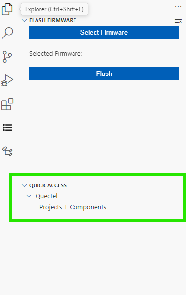
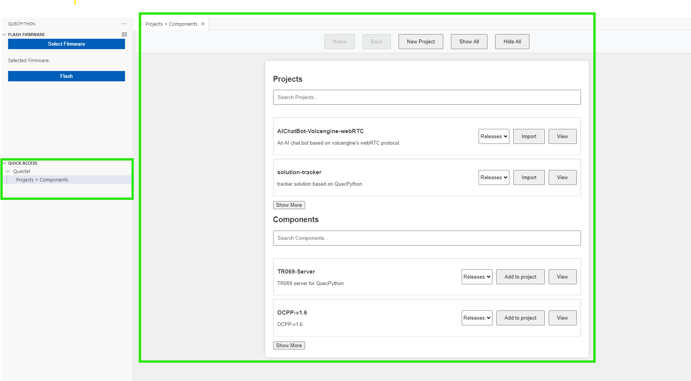
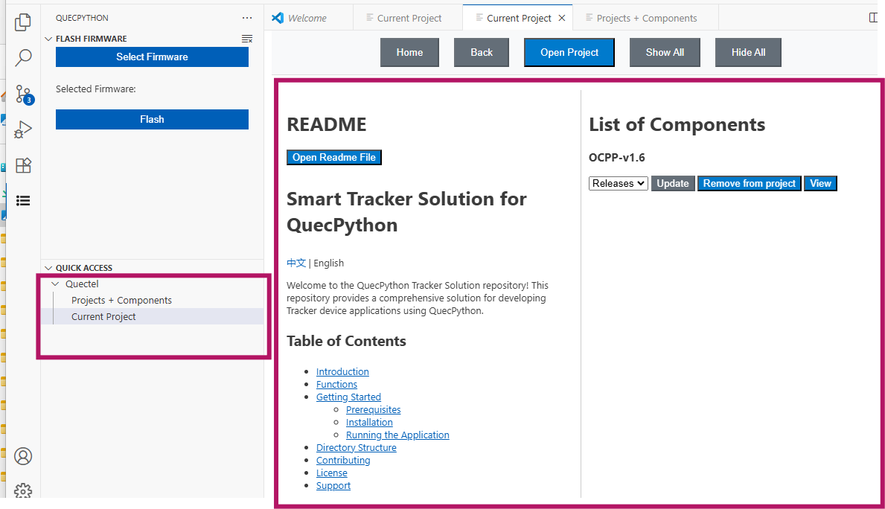
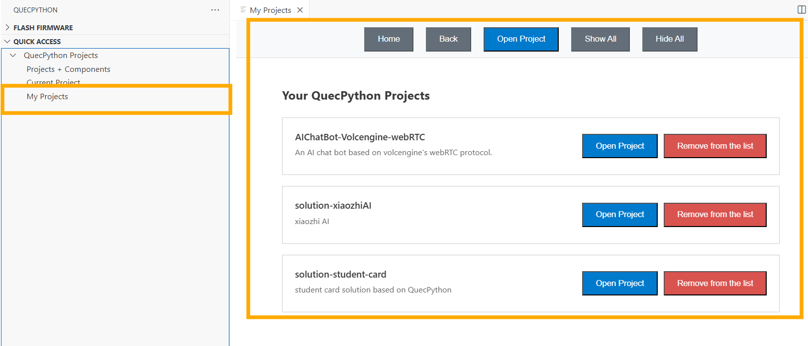

# QuecPython

[English](README.md) | 简体中文

QuecPython VS Code 插件用于与运行 QuecPython 固件的移远模组交互：选择固件、烧录、连接 REPL/AT 串口、下载脚本、运行脚本、浏览设备文件系统，以及管理项目与组件。

## 目录

- [第一部分：用户指南](#user-guide)
- [1. 开始之前](#requirements)
- [2. 安装插件](#installation)
- [3. 界面速览](#interface)
- [4. 快速开始：连接、下载、运行](#quick-start)
- [5. 固件选择与烧录](#firmware)
- [6. 设备文件系统](#file-system)
- [7. 项目与组件](#projects)
- [8. 命令与设置](#settings)
- [9. 常见问题](#faq)
- [10. 问题反馈](#feedback)

# 第一部分：用户指南

## 1. 开始之前

### 模组和 USB 驱动

- 准备支持 QuecPython 的模组/开发板、稳定供电和可传输数据的 USB 线。
- 按准确模组型号安装官方 Windows USB 驱动，并在设备管理器检查端口是否正常枚举。
- 若模组已运行匹配的 QuecPython 固件，可直接进入连接流程，无需重复烧录。
- 若是首次使用或要切换固件，先备份重要设备文件，再按第 5 节烧录。
- REPL、AT、日志和下载接口用途可能不同。端口和波特率应以模组资料及固件说明为准。

## 2. 安装插件

1. 在 VS Code 按 `Ctrl+Shift+X` 打开扩展视图。
2. 搜索 `QuecPython`，确认发布者为 `Quectel`，扩展标识为 `Quectel.qpy-ide`。
3. 点击安装，并按提示启用依赖扩展或重新加载窗口。
4. 点击活动栏 `QuecPython` 图标，检查 `Flash Firmware` 和 `Quick Access` 视图。
5. 在扩展详情页核对版本；不要将其他版本或其他插件的截图当作本机当前界面。

## 3. 界面速览

| 位置 | 功能 |
| --- | --- |
| QuecPython 活动栏：`Flash Firmware` | `Select Firmware` 选择在线/本地固件，`Flash` 启动烧录 |
| `Quick Access > QuecPython Projects` | `Projects + Components`、`Current Project`、`My Projects` |
| 资源管理器：`QPY: File System (usr)` | 浏览设备用户文件，刷新、运行、导出、删除、新建目录 |
| 状态栏 `Connect` / 命令面板 | 打开串口连接；连接后显示 QPY 串口终端 |
| 本地文件或文件夹右键菜单 | `QPY: Download File`、`QPY: Download Folder`、指定路径下载等 |



图中分组名称为旧版 `Quectel`；本文使用本地实现中的 `QuecPython Projects`。

## 4. 快速开始：连接、下载、运行

### 步骤 1：连接模块

1. 用 USB 数据线连接并给模组上电，确认 Windows 已识别串口。
2. 按 `Ctrl+Shift+P`，运行 `QuecPython: Connect to COM Port`，或点击状态栏 `Connect`。
3. 从列表选择目标端口，再选择波特率；列表没有所需值时选择 `[Other]` 输入。
4. 插件打开 `QPY: ...` 终端。连接 REPL 端口时可进行 Python 交互；AT 端口用于 AT 命令。

### 步骤 2：准备脚本

打开独立的本地 QuecPython 项目文件夹，创建并保存 `hello.py`，内容如下：

```python
print("Hello, QuecPython!")
```

### 步骤 3：下载到设备

1. 保持 REPL 连接，选择对应的 QPY 终端。
2. 在资源管理器中右键本地脚本，执行 `QPY: Download File`；下载整个目录使用 `QPY: Download Folder`。
3. 如需指定设备目录，使用 `QPY: Selective Download File`，按提示填写 `/usr/...` 路径，例如 `/usr/demo`。
4. 等待传输完成，刷新 `QPY: File System (usr)`，确认设备侧文件实际存在。

### 步骤 4：运行设备脚本

1. 在 `QPY: File System (usr)` 找到下载后的脚本。
2. 右键执行 `Run Script`。
3. 在 QPY 终端检查 `Hello, QuecPython!` 输出或异常信息。

### 步骤 5：断开连接

切换到目标 QPY 终端，运行 `QuecPython: Disconnect COM Port`。仅隐藏终端面板不会释放串口；烧录或切换到其他串口工具前请明确断开。

## 5. 固件选择与烧录

1. 根据模组准确型号、硬件版本及官方说明准备固件；备份设备内的重要用户文件。
2. 在 `Flash Firmware` 中点击 `Select Firmware`。
3. 选择 `Online Firmware` 时，按提示选择平台、型号和可用版本，等待在线获取完成。
4. 选择 `Local Firmware` 时，选择已获取的匹配固件文件。
5. 释放其他工具占用的相关串口，点击 `Flash`，按当前页面及对应平台工具提示执行端口选择或进入下载模式。
6. 保持供电和 USB 稳定，等待成功结果；失败时保存报错，不要凭界面无变化判断成功。
7. 完成后重新检查设备端口，连接 REPL 验证固件能正常启动。

不同模组的固件包格式、驱动、下载模式和烧录工具可能不同，本文不统一指定某一种固件后缀或硬件按键步骤。固件烧录与 `.py` 文件传输不同，不能把固件包作为普通脚本下载到 `/usr`。

## 6. 设备文件系统

连接 REPL 后，在资源管理器展开 `QPY: File System (usr)`。未自动出现文件时先点击该视图的 `Refresh`。

| 操作 | 入口与说明 |
| --- | --- |
| 刷新 | 视图标题栏 `Refresh`，同步设备文件列表 |
| 运行 | 文件右键 `Run Script`；仅运行适合当前固件的脚本 |
| 导出 | 文件右键 `Export File`，选择电脑保存目录 |
| 删除文件 | `Delete File`，操作设备真实文件，删除前备份 |
| 删除目录 | `Delete Directory`；实现使用 `uos.rmdir`，非空目录可能无法删除 |
| 新建目录 | 视图菜单 `Create Directory`，填写 `/usr/...` 完整路径 |

## 7. 项目与组件

### 7.1 Projects + Components

进入 `Quick Access > QuecPython Projects > Projects + Components`。

1. 在 `Projects` 或 `Components` 区域搜索所需条目。
2. 点击 `View` 查看说明和子模块信息，确认适用的模组、固件和依赖。
3. 导入项目时选择可用版本，再点击 `Import`，选择保存位置，等待克隆完成并打开项目。
4. 给已打开的项目添加组件时点击 `Add to project`；未打开工程时该按钮可能不可用。
5. `New Project` 用于创建工程；`Home`、`Back` 用于页面导航；`Show All`、`Hide All`、`Show More` 控制条目显示。



这是本地项目/组件管理，不等于已经部署到模组。仍需按第 4 节将需要的脚本及依赖传输到设备。

### 7.2 Current Project

先打开插件支持的 QuecPython 项目，再进入 `Current Project` 查看 README 和组件/子模块。按页面提供的操作查看或管理依赖，添加更多组件可返回 `Projects + Components`。



普通文件夹或非 QuecPython 工程可能无法被该页面识别。当前工作区是 UniRTOS C/CMake 工程，不应直接当作 QuecPython 项目；请为 QuecPython 另开目录。

### 7.3 My Projects

`My Projects` 展示通过插件记录的本地项目，可打开项目或从列表移除记录。移除列表记录与删除磁盘目录不是同一概念，应以具体操作提示为准。



## 8. 命令与设置

### 常用命令

| 命令 | 用途 |
| --- | --- |
| `QuecPython: Connect to COM Port` | 选择端口和波特率，建立连接 |
| `QuecPython: Disconnect COM Port` | 断开当前 QPY 串口连接 |
| `QPY: Download File` / `QPY: Download Folder` | 传输本地文件/目录到设备，主要从右键菜单调用 |
| `QPY: Selective Download File` | 指定设备侧下载路径 |
| `QPY: Format Document` | 调用 VS Code 文档格式化，不是设备运行命令 |
| `Set line terminator for active terminal` | 修改当前串口终端的行结束符 |
| `Toggle hex translation for active terminal` | 切换当前终端十六进制接收数据显示方式 |
| `Clear active terminal` | 清空当前终端显示 |

## 9. 常见问题

### 找不到插件面板或激活失败

确认安装的是 `Quectel.qpy-ide`、扩展已启用且 VS Code 版本满足安装版本的兼容要求。更新/重新安装扩展后重载窗口。若报 `NODE_MODULE_VERSION` 或原生串口绑定错误，保存扩展与 VS Code 版本、完整错误提交反馈，不要在已安装扩展目录中随意执行依赖重建。

### No serial devices found / 无法打开串口

在 Windows 设备管理器检查驱动、数据线、供电和端口枚举，关闭 QPYcom、串口监视器等占用工具。重新连接设备后再次选择端口，不能只凭历史 COM 编号判断。

### Device is already connected!

切换到已有 QPY 终端进行操作，或先明确断开再连接。隐藏终端不等于断开。

### AT 能响应但文件树/脚本运行失败

确认连接的是 QuecPython REPL 端口、固件支持 QuecPython 且交互未被运行中的程序占用。AT 接口不是 Python 文件操作通道。

### 脚本修改未生效 / ModuleNotFoundError

确认文件已保存并重新传输到正确设备目录，运行的是设备文件树中的对应文件。检查依赖脚本是否一并下载，以及是否误用了仅适合电脑端 CPython 的包。必要时按应用运行方式重新启动设备或解释器，再检查输出。

### 导入组件或在线固件失败

检查网络、Git、代理、目标目录权限及固件/仓库是否仍可访问。可先获取匹配的本地固件再使用 `Local Firmware`。项目目录有修改时先备份，避免重复导入覆盖文件。

### 文件树为空或删除目录失败

连接 REPL 后手动刷新；确认相关固件接口可用。非空目录不能简单按空目录删除，先核对并备份内容。

## 10.相关链接

- 官方开发者中心：<https://developer.quectel.com/>
- 官方插件指南：<https://developer.quectel.com/doc/quecpython/Application_guide/en/dev-tools/VSCode-Plugin-quecpython/index.html>
